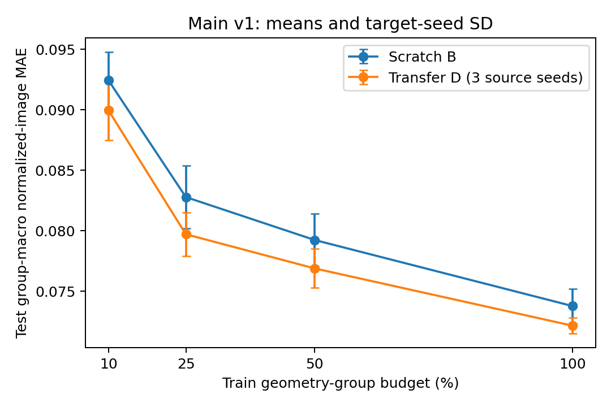
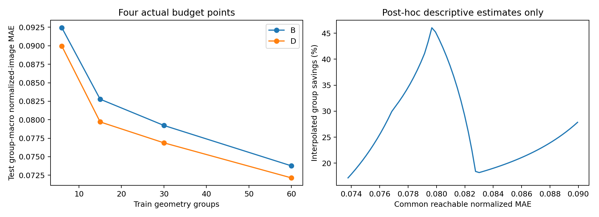

# Antenna-Conditioned Encoder Transfer for Normalized EMF Images: A Geometry-Group Study

Author names and affiliations to be supplied

## Abstract

We investigate whether propagation-supervised encoder initialization improves normalized electromagnetic-field image prediction when target data are limited. A paired convolutional comparison uses identical geometry/transmitter inputs, scalar and radiation-pattern conditioning, and fresh target decoders. An audit identifies 768 base images organized into 86 input-image groups; group-disjoint evaluation uses four training budgets, five target seeds and three source seeds. Transfer reduces mean held-out image-group MAE by 2.20–3.71% across the evaluated budgets. At the prespecified 25% budget, scratch and transfer MAE are 0.082779 and 0.079705; the paired 14-group bootstrap interval for their difference is [0.001823,0.004248]. Supporting experiments isolate pattern information, vary configuration density while retaining all training layouts, and examine an adapted conditioned HRFormer. Source-budget diagnostics and spatial-only controls expose dependence on conditioning and source initialization. Equal-error interpolation suggests data-efficiency gains but is explicitly descriptive, with censoring and uncertainty retained. The study evaluates normalized raster images rather than physical exposure: independent outdoor semantics, absolute-unit inversion and geographic source–target independence remain unresolved.

Keywords: encoder transfer; antenna conditioning; normalized EMF images; geometry-group evaluation; data efficiency

## I. Introduction

Dense field-map prediction can support repeated exploration of urban antenna configurations. When generating target labels is costly, a practical question is whether representations learned from a related propagation task lower prediction error at a fixed target-data budget. The answer requires a scratch comparator with the same target inputs and capacity; a conditioned model beating an unconditioned model does not isolate transfer.

We study encoder transfer from normalized DPM radio-map images to a supplied directional-antenna EMF image dataset. The empirical task is intentionally restricted to the available raster representations. We do not infer physical exposure or independent geographic generalization from grayscale accuracy. A source encoder is transferred, while the target decoder and conditioning components are freshly initialized.

The evidence contribution is a controlled initialization study supported by asset provenance checks, image-group isolation, nested geometry budgets, repeated source/target seeds, parameter-count-matched information controls, and a separate configuration-density axis. FiLM, cross-attention and transformer backbones are established methods; their introduction is not claimed as a contribution.

We distinguish the original prespecified main comparison from follow-up analyses requested after its test results were known. Follow-up settings are fixed before their training and use validation selection, but their held-out results are supporting/exploratory rather than a new blind confirmation. All reported conditions, including adverse transfer outcomes, are retained.

## II. Related Work

RadioUNet develops convolutional propagation-image estimation, and RadioMapSeer supplies simulated radio maps for learning and localization [1,2]. Our small U-Net is a controlled paired backbone, not a reproduction of the official RadioWNet. Transfer between antenna configurations was already studied for tilt-dependent radio maps [8]; transfer learning itself is therefore not new.

FiLM implements feature-wise affine conditioning [3]. HRFormer maintains parallel multiresolution features with local-window attention [4]. The conditioned EMF reference combines multistage scalar FiLM with radiation-pattern attention [5]. Its spatial inputs, outdoor evaluation and random-sample split differ from the audited protocol here; we adapt its mechanisms for a within-backbone scratch/encoder-transfer comparison rather than rank our score against its published score.

BeamRMX treats spatial radiation queries and geometry interactions as central to beam-map prediction [6]. Our available inputs are local one-dimensional patterns without verified world-frame gain conversion, so we do not reproduce its spatial-query protocol. Pattern conditioning and geometry-query interaction are prior work. SSIM is used as a complementary image-structure measure [7], not as physical correctness.

Propagation supervision is used for source learning, but the experiment does not isolate its specificity relative to generic image pretraining or reconstruction pretraining. Such a control is a future mechanism study; the current claims concern measured initialization differences in the supplied tasks.

## III. Data Audit and Problem Definition

The local target assets contain 768 base samples,256 spreadsheet rows with three antenna-number configurations each, and 86 raw building-image identities. Stored flips expand the array to 3072 entries, but are excluded: image/numeric correspondence was verified while local asymmetric pattern reflection was not established. Raw building images and grayscale labels matched all base arrays, and scalar/pattern files were checked against spreadsheet and file conventions. Image identities and D 4-equivalent inputs are grouped before splitting.

The target split contains 60/12/14 training/validation/test image groups and 534/108/126 base samples. These are raw-building/image-geometry groups, not verified independent physical scenes. The local identity counts should not be equated with a differently defined layout count in a reference paper. The source manifest contains 701 DPM maps with 80 transmitters each; its local 701 st map has unresolved original-release provenance. Source map groups are split independently.

Both domains use geometry and transmitter channels. Target geometry is an operational proxy: a pixel is one when both raw B/G channels are exactly zero. Source geometry is binary PNG nonzero. This convention is label-independent but not a recovered simulator footprint. A transmitter channel contains a floor-indexed coordinate marker; source alignment was verified against all antenna PNGs. Renderer and scale differences remain a domain gap.

Scalar input consists of x/y, height, downtilt, power and cyclic azimuth, giving seven features after sine/cosine encoding. Horizontal and vertical patterns each contain 360 ordered samples. Train-subset-only mean/standard-deviation statistics are applied to validation/test inputs. Target supervision is raw grayscale/255; source supervision is normalized DPM gain imagery. Their physical inverse scales are not assumed equivalent.

The stored building mask equals the label-positive mask and changes across settings for most building identities, so it is not promoted to independent occupancy or outdoor ground truth. We score the full raster, retaining zero-valued pixels. No absolute EMF unit, exposure threshold or outdoor-only result is inferred.

Available metadata screening inspected 86 target and 701 source PNGs. It found no geographic PNG fields or target GIS/vector assets. All complete source polygon and antenna files contain local-coordinate lists. An exhaustive 64 x 64 whole-frame D 4 proxy screen made 482,288 comparisons, with maximum IoU 0.4904 and no candidate above 0.75. This cannot rule out crops, overlapping tiles, scale or renderer changes; geographic independence remains unknown.

| Domain/split | Image groups/maps | Base samples/pairs |
| --- | --- | --- |
| Target train | 60 | 534 |
| Target validation | 12 | 108 |
| Target test | 14 | 126 |
| Local source total | 701 | 56080 |

## IV. Paired Encoder Transfer and Conditioning

Let x=(B,T), a denote normalized scalar features and r denote the two angular patterns. A spatial encoder E produces multiscale features, and a target decoder predicts a normalized image. Source learning minimizes whole-raster absolute error on DPM maps. Target adaptation copies only E; target decoder, output head and conditioning weights are initialized from the paired target seed. All encoder layers are then fine-tuned from update 1.

The CNN uses four encoder blocks with 16/32/64/128 channels and a skip-connected decoder. Native 256-pixel source and 500-pixel target rasters are padded to the required pooling multiple and cropped after prediction. Conditioning concatenates a scalar MLP and a one-dimensional pattern encoder, projecting to bottleneck affine parameters. The transformation is F′=(1+gamma(a,r))*F+beta(a,r), with zero-initialized affine output parameters. A/C are spatial-only scratch/source variants; B/D use the same conditioned architecture with scratch/source initialization.

To separate pattern information from parameter count, the scalar-only controls retain the full conditioned CNN but replace normalized pattern tensors by zeros at every train/evaluation step. Scalar inputs remain available. The pattern encoder can learn a constant embedding, but cannot receive sample-specific pattern information. This is an information ablation, not removal of its architecture.

The reference adapter uses a local MIT HRFormer-S backbone lineage with 32/64/128/256 final branches. Scalar FiLM is inserted at four computational stages and a 90-token pattern encoder feeds two 8-head transformer-decoder layers at the deepest branch. Its native 500 output uses a new skip decoder and sigmoid head. Shared two-channel inputs, cyclic scalars, full-raster L 1, no beam/mask/TTA and zero stochastic depth are declared adaptations. We do not claim exact reproduction of the reference method or published outdoor score.

## V. Experimental Protocol

The original primary endpoint is the paired test image-group macro MAE at 25% geometry budget. Training budgets retain 6/15/30/60 complete training groups, nested within each of five target subset/optimizer seeds. D uses three fixed 1500-update source seeds; source checkpoints are selected by fixed source validation probes every 250 updates. Source choice is not selected from target test results. Decoder/conditioning initialization and target subsets are paired.

AdamW uses batch 4, base channels 16, target LR 3 e-4 and weight decay 1 e-4 for the CNN study. The initial cap is 150 epochs with patience 25. Any capped fit is rerun fresh with cap 300 and the same patience; capped originals are preserved. The rule is equal for scratch and transfer. Fresh reruns can differ under nondeterministic CUDA/TF 32 execution. Model selection minimizes validation group-macro MAE, and evaluation manifests are frozen before test inference.

For each sample, MAE and RMSE are computed over the full raster; sample metrics are averaged within each image group, then groups receive equal weight. Seed-averaged per-group errors are paired for 10,000 bootstrap draws across 14 held-out groups. Intervals condition on the split and trained models, rather than treating pixels or reused controls as independent observations. Target/source seed variation is reported separately. Secondary and follow-up intervals are descriptive, with no multiplicity-adjusted significance claim.

Follow-up scalar controls use the same four geometry budgets, five target seeds and three source seeds. The configuration-density axis retains all 60 training image groups and 178 spreadsheet rows, selecting one/two/three antenna-number entries per row with seeded nested rankings. It yields 178/356/534 examples. Those entries can differ in transmitter position and height, so this is not a fixed-transmitter angular-settings experiment. Full-setting references reuse immutable main 100% results.

The reference adapter is compared at 25/100% geometry budgets using three target seeds and one source seed 0. Its source backbone is trained for 1500 updates on the same DPM task. Scratch and transfer receive equal two-candidate validation LR screens,1 e-4/3 e-4, before final training. Reference input/loss/split changes and limited source replication are disclosed. Selection is validation-only, although original test results were already known when these supporting experiments were planned.

## VI. Main Held-Out Image-Group Results

Conditioned encoder transfer lowers mean test MAE at all four sampled budgets. At 25%, B and D score 0.082779 and 0.079705, an absolute difference 0.003074 and relative reduction 3.71%. Its paired geometry-bootstrap interval is [0.001823,0.004248], and 13 of 14 seed-averaged test groups have lower D error. These are conditional empirical image-group results, not independent physical/geographic evidence.

Spatial-only transfer is less consistent: C has higher mean error than A at 10% and 100%, while improvements at 25% and 50% are small. The matched-source 0 interaction (B-D_source 0)-(A-C) is positive at all budgets, but its descriptive 10% interval includes zero. Positive interactions do not establish a physical mechanism or universally beneficial conditioning.

The qualitative example is selected from metadata before examining prediction errors: the lowest base ID within each of four lowest test-group IDs, at 25% budget and target/source seed 0. Shared normalized color scales are used for truth/predictions and absolute errors. This avoids replacing unfavorable examples with hand-selected cases.

| Groups budget | B MAE | D MAE | Reduction | B/D RMSE | B/D SSIM |
| --- | --- | --- | --- | --- | --- |
| 10% | 0.092433 | 0.089948 | 2.69% | 0.133163/0.129707 | 0.8042/0.8060 |
| 25% | 0.082779 | 0.079705 | 3.71% | 0.123513/0.119755 | 0.8521/0.8500 |
| 50% | 0.079228 | 0.076876 | 2.97% | 0.118956/0.115786 | 0.8591/0.8584 |
| 100% | 0.073765 | 0.072139 | 2.20% | 0.112393/0.110423 | 0.8659/0.8648 |

Original main means with target-seed SD; D averages individual-model errors across three source seeds, not an ensemble prediction.

![Metadata-selected representative base 24. Truth and A/B/C/D predictions use a common[0,1] scale; error maps use the same absolute-error scale. Tx/image proxy is shown without asserting physical occupancy.](figures/qualitative.png)

Metadata-selected representative base 24. Truth and A/B/C/D predictions use a common[0,1] scale; error maps use the same absolute-error scale. Tx/image proxy is shown without asserting physical occupancy.

## VII. Supporting Information and Configuration Studies

The scalar-control table reports zero-pattern scalar-only controls. Scalar-minus-full MAE is positive when sample-specific pattern information improves accuracy. Negative differences are retained as evidence of a nonuniform information benefit; the comparison keeps architecture/parameter count fixed and does not isolate every optimization or causal factor.

The configuration-density table varies configuration density at fixed training image-group coverage. Its 100% references are reused main checkpoints, not extra independent replicates. Transmitter coordinates/heights vary across selected antenna-number entries, limiting interpretation to configuration/sample density.

The reference-backbone table gives the adapted HRFormer scratch/source comparison. Within-family initialization comparisons are interpretable under shared inputs and validation budgets. Published reference outdoor/random-split results are not directly ranked against these full-raster/image-group results. Limited source replication and different model capacities prevent universal architectural claims.

Full-pattern inputs lower mean MAE in 6 of eight scalar-versus-full budget/model comparisons. The adapted reference results are 25%: lower transfer MAE (6.54% relative reduction), 100%: lower transfer MAE (8.50% relative reduction). These outcomes qualify the scope of the original conditioned-CNN result.

The cross-backbone table restricts both families to target seeds 0/1/2 and source seed 0. It is descriptive: model capacity, conditioning mechanisms and selected learning rates differ, so it does not isolate the causal effect of the backbone.

| Group budget | Scalar B | Scalar D | B scalar-full | D scalar-full |
| --- | --- | --- | --- | --- |
| 10% | 0.091143 | 0.089090 | -0.001290 | -0.000858 |
| 25% | 0.083916 | 0.081773 | 0.001138 | 0.002068 |
| 50% | 0.083572 | 0.081924 | 0.004344 | 0.005048 |
| 100% | 0.079973 | 0.078335 | 0.006208 | 0.006196 |

| Entries/row | Samples | B MAE | D MAE | Reduction |
| --- | --- | --- | --- | --- |
| 1 | 178 | 0.079061 | 0.078203 | 1.09% |
| 2 | 356 | 0.075247 | 0.073639 | 2.14% |
| 3 | 534 | 0.073765 | 0.072139 | 2.20% |

| Group budget | HRT scratch | HRT transfer | Reduction |
| --- | --- | --- | --- |
| 25% | 0.071946 | 0.067238 | 6.54% |
| 100% | 0.062226 | 0.056937 | 8.50% |

| Group budget | Family | Scratch MAE | Transfer MAE | Reduction |
| --- | --- | --- | --- | --- |
| 25% | cnn | 0.084336 | 0.080533 | 4.51% |
| 25% | hrt_adapter | 0.071946 | 0.067238 | 6.54% |
| 100% | cnn | 0.073758 | 0.071488 | 3.08% |
| 100% | hrt_adapter | 0.062226 | 0.056937 | 8.50% |

## VIII. Source Sensitivity and Descriptive Data Efficiency

Source budgets 500/1500/4500 are compared for seed 0, while source seeds 0/1/2 are compared at 1500 updates. All 30 paired validation comparisons favor D over shared B controls, but they are validation-selected and are not independent control replications. This is not a fully crossed source-budget-by-seed design. Source selected updates, checkpoint hashes and all target histories are retained.

Equal-error analysis interpolates the four observed mean curves in geometry-group count, using a cumulative-minimum monotonic envelope and no extrapolation. At normalized MAE 0.080, point estimates require 26.74 scratch groups versus 14.74 transfer groups, corresponding to 44.87% interpolated savings. These fractional counts were not actually trained, and thresholds were chosen after the original test, so this is descriptive rather than a confirmed data-saving result.

Only 97.28% of paired bootstrap draws identify both requirements inside sampled budgets at that threshold. Censored draws are counted rather than hidden. The reported percentile interval conditions on joint identifiability and is not an unconditional confidence interval. Fresh prespecified equal-error experiments and independent evaluation are required for a stronger claim. Source pretraining cost is additional to target labeling cost.

| Source updates | Source seed | 25% val reduction | 100% val reduction |
| --- | --- | --- | --- |
| 500 | 0 | 2.35% | 1.73% |
| 1500 | 0 | 3.47% | 2.86% |
| 4500 | 0 | 4.47% | 3.61% |
| 1500 | 1 | 3.69% | 3.00% |
| 1500 | 2 | 4.35% | 4.00% |

Four actual budget points and a post-hoc equal-error interpolation curve. Interpolated savings are descriptive; neither extrapolation nor exact empirical savings are asserted.

## IX. Computational Cost and Reproducibility

The reference-backbone tableII reports model-only CUDA-event timing after 50 warmups and 200 timed iterations, with inputs resident on anRTX 4090 GPU. Current shared-GPU load is disclosed. FLOPs include supported convolution/matrix operations and exclude unsupported normalization/activation/interpolation operations; they are not total-algorithm FLOPs. Inference memory uses the process allocator, and synthetic batch 4 forward/backward memory is not a historical training peak.

Recorded source-pretraining and target-adaptation stage runtimes are stored separately, including capped originals and fresh retries. Their wall-time sum is not GPU-active time or end-to-end time. Saved protocol/code/input hashes, group/subset IDs, train normalization, checkpoint selection, per-sample/group metrics, environment versions and failure/cap provenance support reproduction.

Independent audits verify frozen checkpoints, finite strict inference, train-only statistics, group isolation, exact evaluation topology and recalculated MAE/RMSE/SSIM. The original 120 main/spatial checkpoints and all 152 supporting cells are retained. Test values are not used to retrain or reselect checkpoints. Physical unknowns and supporting-test status remain part of the reproducibility record.

| Model | Parameters | Conv/mm GFLOPs | Median ms | Peak alloc MiB |
| --- | --- | --- | --- | --- |
| A | 488561 | 20.638 | 9.143 | 161.2 |
| B | 545121 | 20.639 | 9.149 | 153.7 |
| C | 488561 | 20.638 | 9.140 | 161.2 |
| D | 545121 | 20.639 | 9.136 | 161.4 |

## X. Discussion and Limitations

The measurements support an empirical benefit from conditioned source-encoder initialization on these normalized-image tasks. The spatial-only mixed results and information controls caution against treating pretrained weights or additional antenna inputs as universally beneficial. Encoder transfer and conditioning are evaluated through paired predictors; favorable D-versus-C accuracy alone is not transfer evidence.

The data do not establish verified independent geographic scenes. Scene IDs, tile extents, geographic source-target overlap, independent outdoor/nodata semantics and physical inverse normalization are unavailable. Coarse image nonmatches cannot exclude overlapping crops or different renderers. Image-group bootstrap intervals omit these uncertainties and do not establish real-world exposure accuracy.

The source-budget study is sparse across seeds, and the expensive reference architecture uses a single source seed. Follow-up design occurs after the original test was seen. Its results are transparently supporting rather than new blind confirmation. Generic-image pretraining, additional simulators, frozen encoders and exact fixed-transmitter angular settings remain future studies, not completed evidence.

A larger independent dataset with recoverable scene/geometry metadata and physical labels would permit stronger generalization and exposure claims. A fresh prespecified equal-error study could test interpolated labeling savings. Such work should retain unfavorable outcomes and avoid adapting hyperparameters to the existing held-out errors.

## XI. Conclusion

A paired, audited image-group study finds lower conditioned-CNN test MAE from source encoder transfer across four target geometry budgets, with 3.71% reduction at the prespecified 25% endpoint. Scalar information controls, configuration-density comparisons and an adapted reference backbone provide supporting evidence about the scope of the effect. Data-efficiency interpolation is descriptive, while physical/geographic independence and absolute-unit interpretation remain unresolved. The appropriate conclusion is a bounded normalized-image transfer result rather than an exposure prediction or universal data-saving guarantee.

## References

[1] R. Levie, C. Yapar, G. Kutyniok, and G. Caire, RadioUNet: Fast Radio Map Estimation with Convolutional Neural Networks, arXiv preprint, 2020. https://arxiv.org/abs/1911.09002

[2] C. Yapar, R. Levie, G. Kutyniok, and G. Caire, Dataset of Pathloss and ToA Radio Maps With Localization Application, arXiv preprint, 2024. https://arxiv.org/abs/2212.11777

[3] E. Perez, F. Strub, H. de Vries, V. Dumoulin, and A. Courville, FiLM: Visual Reasoning with a General Conditioning Layer, AAAI, 2018. https://arxiv.org/abs/1709.07871

[4] Y. Yuan, R. Fu, L. Huang, W. Lin, C. Zhang, X. Chen, and J. Wang, HRFormer: High-Resolution Transformer for Dense Prediction, NeurIPS, 2021. https://arxiv.org/abs/2110.09408

[5] D.-E. Kim, D. Park, S. Ahn, N. Kang, S.-h. Kim, and S. Kim, Multi-Modal Conditioned High-Resolution Transformer for Urban Electromagnetic Field Map Prediction, arXiv preprint, 2026. https://arxiv.org/abs/2606.27671

[6] Y. Zhang, X. Wang, W. Chen, and N. Cheng, BeamRMX: Radiation-Pattern-Driven Learning for Generalizable Beam Radio Map Prediction and Beam Management, arXiv preprint, 2026. https://arxiv.org/abs/2609.00615

[7] Z. Wang, A. C. Bovik, H. R. Sheikh, and E. P. Simoncelli, Image Quality Assessment: From Error Visibility to Structural Similarity, IEEE Transactions on Image Processing,13(4), 2004. https://ece.uwaterloo.ca/~z70wang/publications/ssim.html

[8] C. Parera, Q. Liao, I. Malanchini, C. Tatino, A. E. C. Redondi, and M. Cesana, Transfer Learning for Tilt-Dependent Radio Map Prediction, IEEE Transactions on Cognitive Communications and Networking, 2020. https://re.public.polimi.it/handle/11311/1129446
